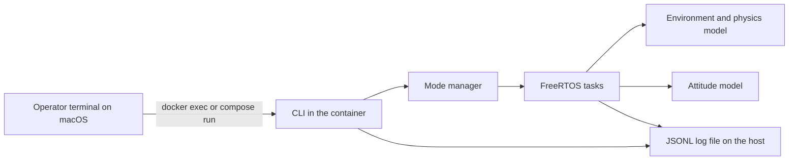

# Gergely point one

## Summary

Gergely point one is the first simulator slice of the Gurgeh CubeSat project. The host is a macOS machine. The simulated satellite is a set of FreeRTOS tasks that run inside a Docker container. This slice covers post-deployment wake-up, a fixed sequence of seven on-orbit checks and actions, and a simple attitude-control model that accepts commands.

A NOS3-style ground link is not part of this slice. The operator interface is a terminal CLI inside the container. There is no status dashboard. Logging is required. Every run writes JSON lines (JSONL) to a host-mounted log file that Jay can follow live from a macOS terminal.

This document records locked decisions, then proposes the structure needed to implement them. Items beyond those decisions are labelled **Proposed**. Details that need a tool or version check are marked **to verify**. This plan does not invent version numbers.

## Decisions

Jay locked the following for this slice:

1. **Host and runtime.** The host is macOS. The simulator runs in a Docker container.
2. **Simulated satellite.** FreeRTOS tasks inside that container are the simulated satellite. A FreeRTOS POSIX/Linux simulator port is the example path. The exact port is **to verify**.
3. **Ground link timing.** A NOS3-style ground link is phase two. It is not part of this first slice.
4. **Mission sequence.** The simulator performs these seven steps, in this order:
   1. Wake up after deployment in orbit.
   2. Check the solar panels.
   3. Check the propellant: confirm the tank is pressurized and the valve responds before trusting it for the de-orbit burn.
   4. Check the antenna to communicate back to the ground station.
   5. Determine its position.
   6. Do three orbits.
   7. Do a controlled de-orbit burn.
5. **Attitude control.** The CubeSat must be able to maneuver and turn. It takes input (commands). Model attitude with reaction wheels or magnetorquers. Magnetorquers are the first pick for a CubeSat this size. Earth pointing is the early priority, for the ground link and the position fix. Moon pointing is a later attitude mode.
6. **Tests.** The test plan covers every one of the seven behaviors plus the attitude-control model. Each item has a test approach: level, nominal pass criteria, fault cases, and expected safe-mode or retry behavior.
7. **Logging.** Comprehensive logging is required. It is not optional. It cannot be turned off. The simulator logs everything with timestamps to a file that can be tailed live from a macOS terminal.
8. **Log format.** The log format is JSON lines (JSONL): one JSON object per line. Use a `.jsonl` file extension.
9. **User interface.** The user interface is a terminal into the Docker container, for example `docker exec -it` or `docker compose run`. The CLI has a subcommand per mission step, a run-all mission subcommand, and status and log helpers.
10. **No dashboard.** There is no status dashboard.

Later code pull requests must adopt Jay's secret-scanning standard v1.

## Scope

### In scope

This slice includes:

- A Docker-hosted FreeRTOS task set that runs on macOS.
- The seven mission steps, in the locked order, with pass and fail handling.
- An attitude-control model that accepts commands and can detumble, point at Earth, and point for the burn. Moon pointing is designed as a later mode, not implemented as a required pass for this slice.
- A simplified environment and physics model: orbit, eclipse, power, propellant, and a de-orbit criterion.
- A terminal CLI into the container, with one subcommand per step, a run-all command, and status and log helpers.
- Required JSONL logging to a host-mounted file and to container stdout.
- Tests for all seven behaviors, attitude control, and one end-to-end mission run.

### Out of scope

This slice does **not** include:

- A NOS3-style ground link, ground-station software, or CCSDS traffic between containers.
- A status dashboard. Jay decided there is no status dashboard. Do not add a web UI, TUI panel, or other graphical status view.
- Flight hardware, a hardware-in-the-loop bench, or a real radio.
- The later lunar skyhook mission (Moon transfer, bucket, regolith, return). This slice is Earth-orbit checkout and a controlled de-orbit only.
- Simulator application code in this document. Command names below are illustrative.

## Architecture overview

The host is macOS. Docker runs one container for the simulated satellite. The operator attaches a terminal to that container and drives the mission with a CLI. FreeRTOS tasks own the steps, attitude, and faults. A mode manager is the single sequencer. All events go to JSONL logs on stdout and to a bind-mounted host folder.

Phase two adds a second container for a NOS3-style ground link. That container is out of scope here.



**Proposed** control flow: the CLI sends a command to the mode manager. The mode manager accepts the command only when prerequisites for that step have passed. Tasks publish results on queues or event groups. The mode manager records the step outcome and writes a JSONL event. On a fault that the step cannot clear, the mode manager enters safe mode and stops the sequence.

## Container setup on macOS

### Host and Docker

Jay locked macOS plus Docker. **Proposed** default: Docker Desktop for Mac, because it is the common macOS install. Alternatives such as Colima or OrbStack are acceptable if they run the same image and bind-mounts. The choice is an open question with Docker Desktop as the recommended default.

### Apple Silicon and x86 images

Apple Silicon hosts may run an `arm64` image natively or an `amd64` image under emulation. Emulation is slower and can change timing. **Proposed:** publish a multi-arch image and prefer the native architecture. Pin the base image name and tag when implementation starts. The exact image and tag are **to verify**. Do not invent a version in this plan.

### Build and run

Plan-level command names only. **Proposed** flow:

1. `docker build` produces the simulator image from a future Dockerfile.
2. `docker run` or `docker compose run` starts the container with a bind-mounted `logs/` folder.
3. The operator uses `docker exec -it <container> <cli> ...` for a running container, or `docker compose run --rm <service> <cli> ...` for a one-shot session.
4. `docker logs -f <container>` follows the same JSONL lines that the process writes to stdout.

No Dockerfile, compose file, or script is part of this document.

### Simulated time

The mission uses two clocks in every log line:

- **Mission time:** simulated time from deployment wake-up, monotonic for this run.
- **Wall-clock UTC:** host-visible UTC in ISO 8601.

**Proposed:** a mission-clock task advances simulated time at a configurable rate (real-time, or a modest speed-up for the three-orbit run). Exact tick source and speed-up factor are **to verify**.

### Logs in the container

The process writes every event as one JSON line to stdout and to a `.jsonl` file under a mounted host directory. See [Logging](#logging). **Proposed** bind-mount: host `logs/` to a container path such as `/var/log/gergely`. The `logs/` directory on the host must be git-ignored when code lands. Do not add a `.gitignore` in this documentation-only change.

## FreeRTOS task structure

The satellite is a FreeRTOS task set inside the container. The POSIX/Linux simulator port is the example. Confirm the port and kernel configuration when code work starts (**to verify**).

Task names, priorities, and periods below are **Proposed**. They are a starting layout, not locked API names. Use a small number of priorities so the POSIX port stays easy to reason about. Lower number means higher priority in this table.

### Proposed tasks

| Task | Responsibility | Proposed priority | Proposed period | Notes |
| --- | --- | --- | --- | --- |
| `ModeManager` | Sequence the seven steps. Enforce prerequisites. Own the mode state machine. Enter and leave safe mode. | 1 (highest application priority) | Event-driven; 100 ms poll as a backstop | Single writer of step state |
| `HealthMonitor` | Watch task heartbeats, raise faults, request safe mode | 2 | 100 ms | Does not command actuators directly |
| `AttitudeControl` | Detumble, point, accept attitude commands | 3 | 10–50 ms | First pick: magnetorquers |
| `PowerMonitor` | Solar-panel state, battery energy, eclipse flag | 4 | 1 s | Feeds step 2 and safe-mode power rules |
| `Propulsion` | Tank pressure, valve response, burn start/stop | 4 | 100 ms when armed; 1 s otherwise | Trusted for burn only after step 3 passes |
| `CommsCheck` | Antenna health and simulated ground-contact flag | 5 | 1 s | No NOS3 link in this slice |
| `Navigation` | Position fix and orbit count | 5 | 1 s | Earth-pointing is a prerequisite for a good fix |
| `MissionClock` | Advance simulated mission time | 6 | 10–100 ms | Source of `mission_time` in logs |
| `Logger` | Serialize JSONL to stdout and the log file | 6 (or a dedicated low-jitter path) | Event-driven | Logging cannot be disabled |
| `CliServer` | Accept CLI subcommands and return status | 5 | Event-driven | Talks only to `ModeManager` and `Logger` |

### Proposed queues, event groups, and timers

| Object | Type | From | To | Purpose |
| --- | --- | --- | --- | --- |
| `qCommand` | Queue | `CliServer` | `ModeManager` | Step, run-all, status, and attitude commands |
| `qStepResult` | Queue | Worker tasks | `ModeManager` | Pass, fail, and reason for a step |
| `qAttCmd` | Queue | `ModeManager` or CLI | `AttitudeControl` | Pointing mode and command input |
| `qAttState` | Queue or notification | `AttitudeControl` | `ModeManager`, `Navigation` | Attitude mode and error |
| `qLog` | Queue | Any task | `Logger` | One log event |
| `egFaults` | Event group | `HealthMonitor`, workers | `ModeManager` | Fault bits: power, propellant, antenna, nav, attitude, burn |
| `egMode` | Event group | `ModeManager` | Workers | Current mode and "safe" bit |
| `tmOrbit` | Software timer | `Navigation` / `MissionClock` | `ModeManager` | Orbit boundary |
| `tmBurn` | Software timer | `Propulsion` | `ModeManager` | Burn duration |

### Mode manager and safe mode

**Proposed** modes: `DEPLOY_WAKE`, `CHECK_SOLAR`, `CHECK_PROP`, `CHECK_ANTENNA`, `FIX_POSITION`, `THREE_ORBITS`, `DEORBIT_BURN`, `MISSION_COMPLETE`, `SAFE`.

Rules:

- The mode manager advances only forward along the seven steps, or into `SAFE`.
- A step starts only when its entry criteria are true. See [Mission steps mapping](#mission-steps-mapping).
- A failed step that cannot be retried, or a fault that breaks a later hazard control (for example a valve that does not respond), sets `SAFE`.
- Safe mode stops propulsion, holds or detumbles attitude, keeps logging, and accepts only status, log, and explicit reset or retry commands.
- There is no skip flag in this slice. The CLI must not offer a hidden bypass.

## Mission steps mapping

The seven steps are locked. Task names and numeric thresholds in this table are **Proposed**.

| Step | Name | Proposed tasks or modules | Entry criteria | Exit (pass) criteria | On failure |
| --- | --- | --- | --- | --- | --- |
| 1 | Wake up after deployment in orbit | `ModeManager`, `MissionClock`, `HealthMonitor`, `AttitudeControl` | Container is running. Mission clock starts. Craft is treated as deployed in orbit. | Tasks are alive. Mission time is running. Detumble has started or is complete enough to proceed. A `step.wake.pass` log event is written. | If bring-up fails, enter safe mode. Retry wake once **Proposed**. Stay in safe mode if the second try fails. |
| 2 | Check the solar panels | `PowerMonitor` | Step 1 passed. | Panels report deployed (or already deployed). Power is positive in sunlight, or the model reports a healthy array. A `step.solar.pass` event is written. | Panel fail-to-deploy or persistent low power: retry **Proposed** once, then safe mode. Do not start later power-hungry steps. |
| 3 | Check the propellant | `Propulsion` | Step 2 passed. | Tank is pressurized above the pass threshold (**to verify**). Valve opens and closes on command. A `step.propellant.pass` event is written. The burn path is now trusted. | Low pressure or stuck valve: do not trust the burn. Enter safe mode. Step 7 must refuse. |
| 4 | Check the antenna | `CommsCheck` | Step 3 passed. Earth-pointing is requested so the antenna geometry is plausible. | Antenna reports ready. Simulated ground-contact check succeeds. A `step.antenna.pass` event is written. | No contact or antenna fault: retry while Earth-pointing **Proposed**. Then safe mode. This slice does not open a NOS3 link. |
| 5 | Determine position | `Navigation`, `AttitudeControl` | Step 4 passed. Attitude is Earth-pointing or within the pointing error limit. | A position fix is available and marked valid. A `step.position.pass` event is written. | Bad or timed-out fix: retry **Proposed** with Earth-pointing held. Then safe mode. |
| 6 | Do three orbits | `Navigation`, `MissionClock`, `PowerMonitor` | Step 5 passed. | The orbit counter increments to 3. Each orbit writes start, end, and count. Eclipse and power stay within safe limits. A `step.orbits.pass` event is written. | Power or attitude fault during the three orbits: abort the count, enter safe mode. Do not start the burn. |
| 7 | Controlled de-orbit burn | `Propulsion`, `AttitudeControl` | Steps 1–6 passed. Step 3 still true (pressure and valve). Attitude is burn-pointing. | Burn starts, runs for the planned duration, reports delta-v, and meets the de-orbit criterion. A `step.deorbit.pass` event is written. Mode becomes `MISSION_COMPLETE`. | If step 3 never passed, the burn **refuses**. If attitude is wrong, abort before ignition. If the burn aborts or misses the criterion, safe mode, valve closed. |

## Attitude control

### Role

The CubeSat must maneuver and turn. Attitude takes input (commands) from the CLI through the mode manager. Earth pointing is the early priority. It supports the antenna check and the position fix. Moon pointing is a later attitude mode. It is not required to complete the seven steps.

### Actuators

Model the plant with **reaction wheels or magnetorquers**. Jay named magnetorquers as the first pick for a CubeSat this size.

**Proposed** first implementation: three-axis magnetorquers plus a simple magnetic-field model. Keep a reaction-wheel model as a switchable option for saturation and wheel-failure tests. Do not invent motor or dipole ratings here. Hardware numbers are **to verify**.

### Sensors

**Proposed** sensor set for the model: body rates, a magnetometer, and a coarse Earth/Sun direction. Sensor noise and bias stay simple. Exact sensor list is **to verify**.

### Modes

| Mode | When | Goal | This slice |
| --- | --- | --- | --- |
| Detumble | After wake-up, and after some faults | Drive body rates down | Required |
| Earth-pointing | Steps 4 and 5, and as the default after detumble | Point the antenna and navigation sensors at Earth | Required; early priority |
| Burn-pointing | Step 7 | Hold the burn direction | Required |
| Moon pointing | Later attitude mode | Point at the Moon | Later; not a pass condition for this slice |

### Command input

Commands are CLI input, not a ground-link packet, in this slice.

**Proposed** command fields: target mode, optional body-frame vector or named target (`earth`, `burn`, `moon`), and a hold-or-slew flag. The attitude task logs the command and the result (accepted, rejected, slew started, on target, failed). The mode manager rejects Moon pointing if a later-mode gate is still closed. It rejects burn-pointing if step 3 has not passed.

## Environment and physics model

Keep the environment simple enough to drive the seven steps and the tests. Fidelity targets below are **Proposed**.

| Domain | Proposed model | Used by |
| --- | --- | --- |
| Orbit | Circular low Earth orbit. Mean motion from a single altitude parameter. No full perturbation stack. Altitude value is **to verify**. | Steps 1, 5, 6, 7 |
| Eclipse | Sun flag off when the Earth occults the Sun along the simplified orbit | Power, solar check, orbit logs |
| Power | Array current when the Sun flag is on and panels are healthy; battery integrator; low-power fault | Steps 2 and 6, safe mode |
| Propellant | Tank pressure state; valve open/closed/stuck; a burn that spends propellant and applies delta-v | Steps 3 and 7 |
| De-orbit criterion | After the burn, altitude or remaining-lifetime proxy drops through a pass threshold | Step 7 pass/fail |
| Attitude plant | Rigid body with magnetorquer (or wheel) torque and a simple disturbance | All pointing modes |

Do not add a high-fidelity atmosphere, a full gravity-gradient stack, or a real TLE propagator unless a later decision says so.

## User interface

### Locked interface

The user interface is a terminal into the Docker container. Examples: `docker exec -it` on a running container, or `docker compose run` for an interactive session. The program is a simple CLI. There is no status dashboard.

### Proposed CLI name and subcommands

**Proposed** CLI name: `gergely`.

| Subcommand | Maps to | Role |
| --- | --- | --- |
| `gergely wake` | Step 1 | Wake up after deployment |
| `gergely check-solar` | Step 2 | Solar-panel check |
| `gergely check-propellant` | Step 3 | Tank pressure and valve response |
| `gergely check-antenna` | Step 4 | Antenna and simulated ground-contact check |
| `gergely position` | Step 5 | Position fix |
| `gergely orbits` | Step 6 | Run three orbits |
| `gergely deorbit` | Step 7 | Controlled de-orbit burn |
| `gergely run` | Steps 1–7 | Run-all mission; stop on first failure |
| `gergely status` | Helper | Print current mode, last step results, and attitude mode |
| `gergely logs` | Helper | Write the log path and, **Proposed**, tail the current run file |

**Proposed** extra for command input, still not a dashboard: `gergely attitude <mode>` sends an attitude command. If this extra is dropped, `gergely run` and the step commands issue the required Earth-pointing and burn-pointing commands themselves.

Illustrative session (names only):

```text
docker exec -it gurgeh-sat gergely status
docker exec -it gurgeh-sat gergely run
docker exec -it gurgeh-sat gergely logs
```

### Step order and prerequisites

The CLI does not run steps out of order.

- Each step subcommand asks the mode manager for permission.
- The mode manager checks the entry criteria in [Mission steps mapping](#mission-steps-mapping).
- If a prerequisite has not passed, the CLI prints a refusal, writes a JSONL `cli.refuse` event, and leaves state unchanged.
- Example: `gergely deorbit` refuses if the propellant check has not passed. It also refuses if any earlier step has not passed, or if attitude is not burn-pointing.
- `gergely run` walks steps 1 through 7 in order. It stops at the first failure or refusal and ends in safe mode when the mode manager requires it.
- `gergely status` and `gergely logs` are always allowed, including in safe mode.

## Logging

Comprehensive logging is **required**. It is not optional. It cannot be turned off. There is no quiet flag and no compile-time off switch in this slice.

### What is logged

The simulator logs everything, with timestamps, including:

- Every check.
- Every step start, pass, fail, and refusal.
- Every mode transition, including safe-mode entry and exit.
- Every attitude command (input and result).
- Every orbit (start, end, count).
- The de-orbit burn (start, duration, delta-v, result).
- Faults, retries, and safe-mode entries.

The test plan asserts that the log contains each expected event.

### Timestamps

Every event carries both clocks:

- Simulated mission time from wake-up.
- Wall-clock UTC, ISO 8601.

### Format (locked)

The log format is **JSON lines (JSONL)**. One JSON object per line. The file extension is `.jsonl`. The format is general-purpose. An operator can `grep` a file or pipe it to tools such as `jq`.

**Proposed** standard fields (the JSONL decision is locked; these keys are a proposal):

| Field | Meaning |
| --- | --- |
| `mission_time` | Simulated mission time, **Proposed** as a decimal second count from wake-up |
| `utc` | Wall-clock UTC, ISO 8601 |
| `level` | `INFO`, `WARN`, `ERROR`, or `DEBUG` |
| `subsystem` | Task or subsystem name |
| `event` | Stable event name, for example `step.solar.pass` |
| `data` | Event-specific object |

Illustrative lines (field names **Proposed**):

```json
{"mission_time":12.040,"utc":"2026-10-24T12:00:12.040Z","level":"INFO","subsystem":"ModeManager","event":"step.solar.pass","data":{"step":2,"panels":"deployed","sun":true}}
{"mission_time":4810.200,"utc":"2026-10-24T13:20:10.200Z","level":"ERROR","subsystem":"Propulsion","event":"fault.valve.stuck","data":{"step":3,"valve":"stuck_closed","trusted_for_burn":false}}
```

### Where logs go

- A log file on a mounted host folder. **Proposed:** bind-mount host `logs/` into the container. **Proposed** file name per run: `logs/gergely-<utc-or-run-id>.jsonl`.
- Jay can follow the file from a macOS terminal with `tail -f`.
- The same JSON lines go to the container's stdout so `docker logs -f` shows the same stream.

The host `logs/` directory must be git-ignored when repository code exists. This documentation-only change does not add a `.gitignore`.

## Test plan

Tests cover every one of the seven behaviors and the attitude-control model. Each behavior has a unit or task-level check, a fault injection, and a place in the end-to-end mission run. Pass criteria include the JSONL events named below.

Tooling for running tests is **Proposed**. See [How tests run in Docker on macOS](#how-tests-run-in-docker-on-macos).

### Summary

| Behavior | Levels | Nominal pass (log events) | Example faults | Safe-mode or retry |
| --- | --- | --- | --- | --- |
| 1. Wake after deployment | Unit, task, end-to-end | `step.wake.start`, `step.wake.pass`; mission clock running | Task fail-to-start; clock not advancing | Retry wake once **Proposed**; then `mode.safe.enter` |
| 2. Solar panels | Unit, task, end-to-end | `step.solar.pass`; power healthy in sun | Panel fails to deploy; array dead in sun | Retry once **Proposed**; then safe mode; later steps refused |
| 3. Propellant | Unit, task, end-to-end | `step.propellant.pass`; `trusted_for_burn: true` | Low tank pressure; stuck valve | No burn trust; `gergely deorbit` refuses; safe mode |
| 4. Antenna and ground contact | Unit, task, end-to-end | `step.antenna.pass`; simulated contact true | Antenna fault; no ground contact | Retry with Earth-pointing **Proposed**; then safe mode |
| 5. Position | Unit, task, end-to-end | `step.position.pass`; fix valid | Bad fix; timeout; pointing off Earth | Retry while Earth-pointing; then safe mode |
| 6. Three orbits | Task, end-to-end | Three `orbit.start` / `orbit.end` pairs; `step.orbits.pass`; count 3 | Power fault in eclipse; attitude loss | Abort count; safe mode; no burn |
| 7. Controlled de-orbit burn | Unit, task, end-to-end | `burn.start`, duration, delta-v, `step.deorbit.pass` | Burn with failed prop check (must refuse); wrong attitude; aborted burn | Refuse or abort; valve closed; safe mode |
| Attitude control | Unit, task, end-to-end | Command logged; detumble; Earth-pointing within error; burn-pointing held | Wheel failure or saturation; magnetorquer off; reject Moon mode if gated | Hold or detumble; safe mode if pointing is required and cannot be met |

### 1. Wake up after deployment

- **Levels:** unit for clock and task-create helpers; task/integration for bring-up; included in the end-to-end run.
- **Nominal:** after `gergely wake` or `gergely run`, tasks are alive, mission time increases, detumble is requested, and the log has `step.wake.start` and `step.wake.pass`.
- **Faults:** a required task does not start; mission time does not advance.
- **Expected:** one retry **Proposed**. Persistent failure writes `step.wake.fail` and `mode.safe.enter`. Step subcommands after wake refuse.

### 2. Solar panels

- **Levels:** unit for the panel and power model; task/integration for `PowerMonitor`; end-to-end.
- **Nominal:** panels deploy or report already deployed. In sunlight, power is above the pass floor. Log has `step.solar.pass`.
- **Faults:** a panel fails to deploy; the array stays at zero in sunlight.
- **Expected:** retry once **Proposed**. Then `step.solar.fail` and safe mode. Steps 3–7 refuse.

### 3. Propellant check

- **Levels:** unit for pressure and valve models; task/integration for `Propulsion`; end-to-end.
- **Nominal:** tank pressurized; valve opens and closes; `step.propellant.pass` and `trusted_for_burn: true`.
- **Faults:** low tank pressure; valve stuck open or stuck closed.
- **Expected:** `trusted_for_burn` stays false. Safe mode. `gergely deorbit` refuses. This is a hard gate, not a warning.

### 4. Antenna and ground link

- **Levels:** unit for the antenna model; task/integration for `CommsCheck`; end-to-end.
- **Nominal:** antenna ready; simulated contact succeeds while Earth-pointing; `step.antenna.pass`.
- **Faults:** antenna failed; no ground contact.
- **Expected:** retry while holding Earth-pointing **Proposed**. Then safe mode. This slice does not start a NOS3 stack. "Ground link" here means the simulated contact check only.

### 5. Position

- **Levels:** unit for the fix validity rules; task/integration for `Navigation`; end-to-end.
- **Nominal:** Earth-pointing is within limit; a valid fix is published; `step.position.pass`.
- **Faults:** bad position fix; fix timeout; attempt while not Earth-pointing.
- **Expected:** retry with Earth-pointing held **Proposed**. Then `step.position.fail` and safe mode. `gergely orbits` refuses.

### 6. Three orbits

- **Levels:** task/integration for the orbit counter; end-to-end. Unit tests for count and eclipse edges.
- **Nominal:** three orbits complete. Each orbit logs `orbit.start`, `orbit.end`, and `count`. Then `step.orbits.pass` with `count: 3`.
- **Faults:** low power in eclipse; attitude loss during the run.
- **Expected:** abort the remaining orbits, write `step.orbits.fail`, enter safe mode. `gergely deorbit` refuses.

### 7. Controlled de-orbit burn

- **Levels:** unit for delta-v and the de-orbit criterion; task/integration for armed burn; end-to-end.
- **Nominal:** prerequisites passed; burn-pointing held; burn start, duration, delta-v, and result are logged; criterion met; `step.deorbit.pass`.
- **Faults:** burn requested when the propellant check has not passed; burn with a stuck valve or low pressure; attitude not burn-pointing; aborted burn (cut early or off-axis).
- **Expected:** refuse if step 3 has not passed or attitude is wrong (`cli.refuse` or `step.deorbit.refuse`). If a started burn aborts, close the valve, write `step.deorbit.fail`, enter safe mode.

### Attitude control model

- **Levels:** unit for the plant and mode logic; task/integration for command input and mode changes; end-to-end during steps 1, 4, 5, and 7.
- **Nominal:** a command is logged as input and as result. Detumble reduces rate. Earth-pointing stays within the error limit for the antenna and position steps. Burn-pointing holds through the burn. Moon pointing is accepted only as a later mode when that gate is open.
- **Faults:** reaction-wheel failure or saturation (when the wheel model is enabled); magnetorquer failed-off; a command for Moon pointing while the later-mode gate is closed; inability to hold Earth-pointing or burn-pointing.
- **Expected:** reject illegal commands and log the rejection. On actuator fault, try the remaining actuator model if both exist; otherwise detumble or hold and raise a fault. If a required pointing mode cannot be met, the current step fails and the mode manager enters safe mode.

### End-to-end mission test

One mission run uses `gergely run` (or the seven step commands in order) with a healthy environment.

Pass when:

- Steps 1–7 all pass, in order, with no skip.
- Attitude uses detumble, then Earth-pointing, then burn-pointing.
- The log file is JSONL. It contains each required event for checks, mode transitions, attitude commands, three orbits, and the burn (start, duration, delta-v, result).
- The same lines appear on stdout.
- The process ends in `MISSION_COMPLETE`, not safe mode.

A second end-to-end run injects at least one hard fault (stuck valve or failed panels) and checks that the sequence stops, the burn does not occur, safe mode is logged, and later CLI step commands refuse.

### How tests run in Docker on macOS

Tests run in the same class of container that the operator uses. **Proposed** pattern:

1. `docker build` the simulator image on the Mac.
2. `docker run` (or `compose run`) with `logs/` mounted.
3. A test entrypoint, **Proposed** name `gergely-test` or a container `CMD` such as `ctest` / `pytest`, is **to verify**. Do not lock a framework in this plan.
4. Tests call the same CLI subcommands where possible, then read the `.jsonl` file and assert events with `jq` or a small parser.
5. Fault cases pass an environment flag or a **Proposed** `gergely-test inject <fault>` helper. That helper is test-only.

The test-runner choice remains an open question. The recommended default is: run the real CLI in Docker and assert JSONL events.

## Phase two: NOS3-style ground link

Phase two is not this slice. This section only records what comes next so the first slice does not block it.

### What NASA NOS3 is

NASA NOS3 (NASA Operational Simulator for Small Satellites) is a software-in-the-loop environment. It connects flight software, a dynamics and environment model, and ground software so a small-satellite team can run missions on a desk. Confirm current NOS3 components and versions when phase two starts (**to verify**).

### What an adapted version would look like

**Proposed** adaptation for Gurgeh:

| Topic | Proposed direction |
| --- | --- |
| Packet format | CCSDS space packets (or a thin CCSDS-like header) between ground and flight containers. Exact APID map is **to verify**. |
| Transport | A user-space link between containers: a virtual serial port, UDP, or a software bus. Choice is **to verify**. |
| Ground software | A lightweight command and telemetry client. Candidates such as COSMOS or a NOS3-bundled ground app are **to verify**. |
| Layout | `docker compose` with at least `sat` (this slice) and `ground`. A later `dynamics` service if the in-process physics model moves out. |
| This slice | Keep a `CommsCheck` seam (antenna ready, contact flag) so phase two can replace the flag with real packets without changing steps 1–3, 5–7. |

Do not add compose services, packet code, or ground UI in Gergely point one.

## Proposed milestones

Each milestone is small. Verification is listed. When code exists, every code pull request must adopt Jay's secret-scanning standard v1. This documentation-only change does not add scanner config.

| ID | Milestone | Verification |
| --- | --- | --- |
| M1 | Container runs on macOS Docker and prints JSONL to stdout and a mounted `logs/*.jsonl` file | `tail -f` on the host file and `docker logs -f` show the same lines; `gitleaks` clean |
| M2 | CLI skeleton: `status`, `logs`, and step subcommands that refuse out-of-order calls | `gergely deorbit` before step 3 prints refuse and logs `cli.refuse` |
| M3 | Mode manager sequences steps 1–2 with the power model | Nominal solar pass; fail-to-deploy case enters safe mode |
| M4 | Propellant check and burn gate | Pass sets `trusted_for_burn`; low pressure or stuck valve blocks `deorbit` |
| M5 | Antenna check and position fix with Earth-pointing | Both pass only while pointing is within limit; bad fix fails |
| M6 | Three-orbit run with eclipse and power | Count reaches 3; orbit events in the log |
| M7 | Attitude modes: detumble, Earth-pointing, burn-pointing; command input | Unit and task tests; wheel or magnetorquer fault case |
| M8 | Controlled de-orbit burn and criterion | Nominal burn passes; abort and refuse cases |
| M9 | `gergely run` end-to-end plus the fault end-to-end | Test plan section above is green in Docker on macOS |
| M10 | Phase-two seam note only: contact flag isolated | No NOS3 containers yet; interface documented in code comments when they exist |

## Open questions and decisions

Each item still open has a recommended default. Questions that the decisions section already answered (host, Docker, seven-step order, no NOS3 in this slice, required JSONL logging, CLI rather than a dashboard) are not listed again.

| ID | Question | Recommended default |
| --- | --- | --- |
| Q1 | Which FreeRTOS simulator port and kernel config? | POSIX/Linux simulator port; exact source and version **to verify** |
| Q2 | Docker Desktop, Colima, or OrbStack on macOS? | Docker Desktop |
| Q3 | Image architecture on Apple Silicon? | Native `arm64`, with `amd64` documented as emulated |
| Q4 | Base image and tag? | A current official slim Linux image; name and tag **to verify** |
| Q5 | Mission-clock rate? | Real-time first; optional modest speed-up for three orbits, factor **to verify** |
| Q6 | Magnetorquers first, wheels first, or both models? | Magnetorquers first, as Jay's first pick; wheels available for fault tests |
| Q7 | Orbit altitude and de-orbit pass threshold? | A single LEO altitude parameter and a simple altitude-drop criterion; numbers **to verify** |
| Q8 | CLI binary name? | `gergely` |
| Q9 | Test runner inside the container? | Drive the real CLI and assert JSONL; framework **to verify** |
| Q10 | Phase-two transport and ground client? | Decide in phase two; keep only a contact-flag seam now |
| Q11 | Log field names and `mission_time` unit? | Fields in the Logging table; seconds from wake-up |
| Q12 | Bind-mount path and run file name? | Host `logs/gergely-<run-id>.jsonl`; `logs/` git-ignored when code lands |
